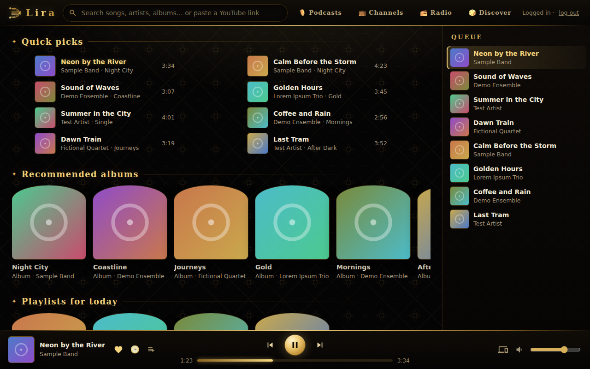

# Lira — okno i zasobnik odtwarzacza muzyki

🇬🇧 [English version](README.md)



*Zrzut z przykładowymi danymi — podgląd angielskiego interfejsu.*

Dwie małe aplikacje na pulpit Linuksa (Rust) do odtwarzacza muzyki **Lira**:

- **`muzyka-okno`** — okno (GTK3 + WebKitGTK) z interfejsem odtwarzacza, bez belki tytułowej (górny pasek strony służy za belkę), logowanie do YouTube Music w oknie.
- **`muzyka-zasobnik`** — ikona w zasobniku (StatusNotifierItem) + sterowanie MPRIS: graj/pauza, następny/poprzedni, otwarcie okna.

> **Serwer w paczce:** katalog `lira-serwer/` to backend (lokalny serwer HTTP na
> `127.0.0.1:26540`, który wyszukuje i odtwarza muzykę przez `mpv`/`yt-dlp`). Wszystko działa na
> jednym komputerze — zob. [`lira-serwer/README.md`](lira-serwer/README.md). Interfejs po angielsku i po polsku.

## Szybki start (lokalnie, jeden komputer)

```sh
sudo apt install mpv python3-venv      # albo odpowiednik w Twojej dystrybucji; yt-dlp doinstaluje pip
cd lira-serwer
python3 -m venv venv && . venv/bin/activate
pip install -r requirements.txt
python3 lira_serwer.py                 # http://127.0.0.1:26540/ (--host / --port zmieniają adres)
```

Potem otwórz `http://127.0.0.1:26540/` w przeglądarce albo zbuduj i uruchom `muzyka-okno` / `muzyka-zasobnik`.
Opcjonalnie usługa systemd --user — zob. `lira-serwer/lira-serwer.service`.
Konfiguracja: `~/.config/lira-serwer/config.json` (`lira-serwer/config.example.json`); dane: `~/.local/share/lira-serwer`.

## Opcjonalnie: serwer w domu

Serwer może też działać na mini-PC / Raspberry Pi / NAS i obsługiwać inne urządzenia w sieci:
uruchom go z `--host 0.0.0.0` (token dostępu powstaje automatycznie; na każdym urządzeniu otwórz raz
`http://HOST:26540/?t=TOKEN`), a okno skieruj na niego: `MUZYKA_URL=http://serwer-domowy:26540/ muzyka-okno`.
Do dostępu spoza domu używaj VPN/tunelu — nie wystawiaj serwera publicznie.

Funkcje: **Twoje playlisty i polubione** z własnego konta YouTube Music (logowanie w oknie), odtwarzanie przez `mpv`; **radio** internetowe (ulubione stacje), **podcasty** i kanały YouTube (lista „Do posłuchania”), zakładka **Odkrywaj**, wyszukiwarka, kolejka, interfejs EN/PL.

**Serwera w domu nie trzeba** — backend działa na tym samym komputerze
(`127.0.0.1:26540`, ustawienie domyślne okna i zasobnika).

## Funkcje
- okno: interfejs serwera w WebKitGTK, własne przyciski okna, przekazanie ciasteczek logowania YouTube Music do lokalnego serwera (`/api/zaloguj`)
- zamknięcie okna nie zatrzymuje muzyki — sterowanie zostaje w zasobniku i klawiszach multimediów
- zasobnik: menu z bieżącym utworem, sterowanie, wybór urządzenia, MPRIS (klawisze multimediów, aplet dźwięku)

## Wymagania
- backend `lira-serwer` na `127.0.0.1:26540` (osobny projekt, zob. wyżej)
- Linux z GTK3 + WebKitGTK 4.1 (`libwebkit2gtk-4.1-dev`, `libgtk-3-dev`, `libsoup-3.0-dev`), D-Bus, Rust (rustup)
- zasobnik obsługujący StatusNotifierItem

## Budowanie
```sh
(cd muzyka-okno && cargo build --release && cp target/release/muzyka-okno ~/.local/bin/)
(cd muzyka-zasobnik && cargo build --release && cp target/release/muzyka-zasobnik ~/.local/bin/)
```
Zasobnik uruchamia okno z `~/.local/bin/muzyka-okno`.

## Konfiguracja
- `MUZYKA_URL` — adres interfejsu dla okna (domyślnie `http://127.0.0.1:26540/`); używany też do przekazania logowania (`/api/zaloguj`)
- `LIRA_SERWER` — `host:port` serwera dla zasobnika (zapasowo host:port z `MUZYKA_URL`, potem `127.0.0.1:26540`)
- język interfejsu: `?lang=en|pl`, przycisk 🌐 albo język przeglądarki (polski → pl, inaczej en)
- ciasteczka logowania trzyma backend, nie te programy

## Stan / plany
Backend (`lira-serwer`) i interfejs EN/PL są w repozytorium. Klienci Windows/Android i przełączanie „Graj na:” między urządzeniami nie są częścią tego repozytorium.

---

**Zastrzeżenie:** Prywatny projekt hobbystyczny, tworzony do nauki i własnego użytku. Nie jest powiązany z YouTube ani Google. Korzysta z otwartych narzędzi (m.in. mpv, yt-dlp, WebKitGTK). Każdy użytkownik loguje się własnym kontem i sam odpowiada za zgodność z regulaminem serwisu. Oprogramowanie udostępniane „tak jak jest”, bez gwarancji.

Licencja: MIT — zob. [LICENSE](LICENSE).
